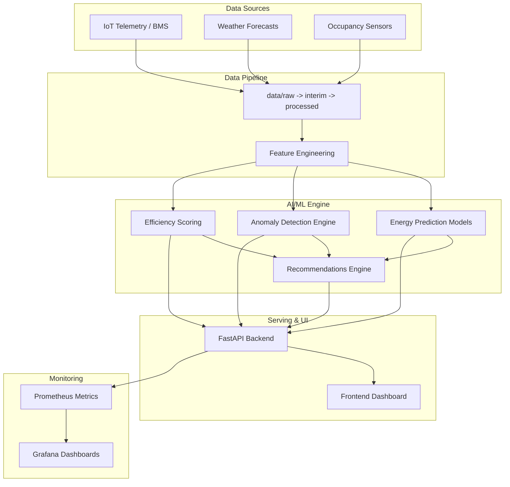

# 🌱 AI-Based Green Building Assistant

[](https://www.python.org/)
[](LICENSE)
[]()

An end-to-end intelligent platform for monitoring, predicting, and optimizing energy consumption, operational efficiency, and sustainability compliance in smart and green buildings.

---

## 📌 Table of Contents

- [Overview](#-overview)
- [Key Features](#-key-features)
- [System Architecture](#-system-architecture)
- [Directory Structure](#-directory-structure)
- [Tech Stack](#-tech-stack)
- [Getting Started](#-getting-started)
- [Project Roadmap](#-project-roadmap)
- [Contributing](#-contributing)
- [License](#-license)

---

## 🌟 Overview

The **AI-Based Green Building Assistant** leverages machine learning and IoT telemetry to provide actionable insights for building managers, sustainability officers, and facility engineers. By analyzing historical and real-time sensor data (HVAC, lighting, occupancy, weather), the system minimizes carbon footprint, lowers operational expenditures, and assists in green building standard compliance (LEED, BREEAM, etc.).

---

## 🚀 Key Features

* **⚡ Energy Consumption Forecasting**: High-accuracy time-series models to predict power, heating, and cooling loads.
* **🚨 Telemetry Anomaly Detection**: Unsupervised and semi-supervised anomaly detection for HVAC malfunctions and energy leaks.
* **📊 Efficiency Benchmarking**: Continuous scoring against international green building benchmarks.
* **💡 Smart Recommendations**: Rule-based and model-driven recommendations for load shedding, setpoint adjustments, and occupancy optimization.
* **🖥️ Interactive Dashboard**: Real-time visualization interface for building telemetry, analytics, and operational controls.
* **📈 Observability & Alerting**: Production-grade metrics monitoring via Prometheus and Grafana dashboards.

---

## 🏗️ System Architecture



---

## 📁 Directory Structure

```text
ai-green-building/
├── .github/
│   └── workflows/            # GitHub Actions CI/CD pipelines
├── artifacts/
│   ├── models/               # Serialized model checkpoints and weights
│   └── reports/              # Automated pipeline run summaries & metadata
├── configs/                  # Environment, model, and pipeline configurations
├── data/
│   ├── external/             # Third-party datasets (weather data, benchmarks)
│   ├── interim/              # Partially transformed intermediate data
│   ├── processed/            # Canonical datasets ready for model training
│   └── raw/                  # Immutable original sensor logs and dumps
├── deployment/
│   ├── huggingface/          # Hugging Face Spaces deployment manifests
│   └── nginx/                # Reverse proxy and gateway configurations
├── docs/                     # Technical specifications and API documentation
├── frontend/
│   ├── public/               # Static assets
│   └── src/
│       ├── components/       # Reusable UI elements
│       ├── pages/            # Application views (Dashboard, Analytics, Alerts)
│       ├── services/         # API clients and data fetchers
│       └── types/            # TypeScript type declarations
├── monitoring/
│   ├── alerts/               # Alertmanager rules and trigger definitions
│   ├── grafana/
│   │   ├── dashboards/       # JSON dashboard templates
│   │   └── provisioning/     # Automated datasources & dashboards setup
│   └── prometheus/           # Prometheus scraping configurations
├── notebooks/                # Exploratory data analysis (EDA) and research
├── pipelines/                # Data pipelines and training automation scripts
├── reports/
│   ├── evaluation/           # Model validation and benchmark reports
│   └── figures/              # Generated plots and visualizations
├── src/
│   └── green_building/       # Core application package
│       ├── api/              # RESTful API application and routes
│       ├── data/             # Ingestion and raw data handlers
│       ├── evaluation/       # Performance metrics and evaluation logic
│       ├── features/         # Feature engineering transforms
│       ├── models/           # Model definitions and architectures
│       │   ├── anomaly_detection/
│       │   ├── common/
│       │   ├── efficiency/
│       │   └── energy_prediction/
│       ├── monitoring/       # Application telemetry and data drift tracking
│       ├── recommendations/  # Optimization recommendation engine
│       ├── tracking/         # Experiment tracking and logging utilities
│       └── utils/            # Shared helper functions
└── tests/
    ├── integration/          # Multi-component and API integration tests
    ├── smoke/                # Deployment and pipeline health smoke tests
    └── unit/                 # Unit tests for functions and classes
```

---

## 🛠️ Tech Stack

* **Backend & API**: Python 3.10+, FastAPI, Uvicorn, Pydantic
* **Machine Learning**: Scikit-Learn, XGBoost, PyTorch / TensorFlow, Statsmodels
* **Data Management**: Pandas, NumPy, Polars, DVC
* **Frontend**: React / Vite / TypeScript, Tailwind CSS, Chart.js / Recharts
* **Monitoring & Ops**: Prometheus, Grafana, Docker, Nginx, GitHub Actions

---

## 🚦 Getting Started

### 1. Clone the Repository
```bash
git clone https://github.com/your-username/ai-green-building.git
cd ai-green-building
```

### 2. Environment Setup
```bash
# Create and activate virtual environment
python -m venv .venv
source .venv/bin/activate  # On Windows: .venv\Scripts\activate

# Install dependencies (once requirements.txt is configured)
# pip install -r requirements.txt
```

### 3. Running the Services
```bash
# Backend API (placeholder command)
# uvicorn src.green_building.api.routes:app --reload

# Frontend (placeholder command)
# cd frontend && npm install && npm run dev
```

---

## 🗺️ Project Roadmap

- [x] Repository and directory structure initialization
- [ ] Exploratory Data Analysis (EDA) on building energy datasets
- [ ] Data preprocessing & feature engineering pipeline
- [ ] Baseline energy prediction model training & evaluation
- [ ] HVAC anomaly detection module implementation
- [ ] FastAPI backend service development
- [ ] Frontend dashboard implementation
- [ ] Prometheus & Grafana observability setup
- [ ] CI/CD automation & containerized deployment

---

## 🤝 Contributing

Contributions, issues, and feature requests are welcome! Feel free to check the issues tab once available.

---

## 📄 License

This project is licensed under the MIT License - see the `LICENSE` file for details.
